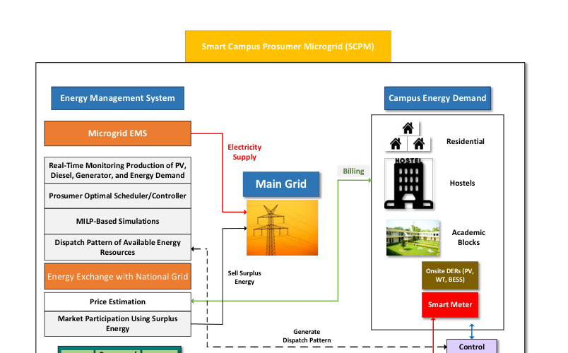

# Campus-Microgrid-EMS

Optimal energy management for a campus microgrid, with demand response and an economic analysis. First author: Haseeb Javed.

[](https://doi.org/10.3390/en14248501)
[](https://github.com/haseebjaved123/CampusMG_Energies_2021)



## What it is

Optimal energy management for a campus microgrid, with demand response and an economic analysis. First author: Haseeb Javed. Venue: Energies, vol. 14, no. 24, 8501, 2021.

## Why it matters

The paper is part of the published record on energy systems. This repository records the bibliographic facts and the figure used on the project site. It does not add unpublished measurements.

## Citation

```bibtex
@article{javed2021campus,
  title={Optimal Energy Management of a Campus Microgrid Considering Financial and Economic Analysis with Demand Response Strategies},
  author={Javed, Haseeb and Muqeet, Hafiz Abdul and Shehzad, Moazzam and Jamil, Mohsin and Khan, Ashraf Ali and Guerrero, Josep M.},
  journal={Energies},
  year={2021},
  doi={10.3390/en14248501}
}
```

## License

MIT for notes and helper code in this repository. The article remains with its publisher.
